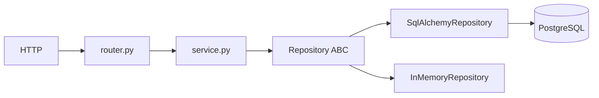

# Сириус.Еда

API столовой. Четыре модуля — `users`, `menu`, `orders`, `delivery` — начинались как MVP: приём HTTP, бизнес-правила и SQL находились в одном обработчике. Каждый модуль разложен на три слоя Clean Architecture. Внешние пути, коды ответов и тексты ошибок сохранены.

## Слои

Зависимости направлены внутрь. `service.py` не импортирует `fastapi` и `sqlalchemy`.



| Файл | Слой | Зона ответственности |
| --- | --- | --- |
| `router.py` | транспорт | HTTP, техническая валидация, перевод доменных исключений в статусы |
| `service.py` | бизнес-логика | правила предметной области, сценарий |
| `repository.py` | инфраструктура | ABC, PostgreSQL и in-memory |

Пример пути `POST /orders/create`:

1. Роутер проверяет, что `quantity > 0`. Иначе `400`.
2. Фабрика `create_order_repository` собирает хранилище, сервис получает его в конструктор.
3. Сервис проверяет пользователя, блюдо, доступность и баланс. Нарушения становятся `NotFoundError` (`404`) или `BusinessRuleError` (`400`).
4. Репозиторий списывает баланс и сохраняет заказ со статусом `processing`.
5. Роутер возвращает `{"status": "success", "order_id": ...}`.

Техническая проверка и бизнес-проверка разведены. Формат email задаёт `EmailStr` в схеме, длина телефона, знак суммы, цена и длина названия — в роутере. Уникальность email и названия, блокировка, лимит пополнения 50 000, доступность блюда, баланс и правила курьера — в сервисе. Порядок проверок совпадает с MVP: например, занятый email сообщается раньше короткого телефона, а отсутствующее блюдо — раньше неположительной цены.

## Подмена репозитория

Сервис зависит от абстракции (`OrderRepository` и аналоги), а не от PostgreSQL. Конкретный класс выбирает фабрика в `repository.py`:

```bash
# по умолчанию PostgreSQL
uvicorn app.main:app --reload

# та же сборка роутера и сервиса, другое хранилище
REPOSITORY_BACKEND=memory uvicorn app.main:app --reload
```

Менять `service.py` и `router.py` для этой замены не нужно. Unit-тесты делают то же самое напрямую: передают `InMemory*Repository` в конструктор сервиса и не поднимают СУБД.

## Запуск

```bash
python3 -m venv .venv
source .venv/bin/activate
pip install -r requirements.txt

docker compose up -d db redis
uvicorn app.main:app --reload
```

Документация: http://127.0.0.1:8000/docs

В логе сервера видны SQL-запросы `INSERT` и `UPDATE`: у движка включён `echo`.

Тесты без Docker и PostgreSQL:

```bash
pytest
```

На Python 3.13 три пина из задания подняты в тех же мажорных линиях, потому что у исходных версий нет колёс: `psycopg2-binary==2.9.10`, `pydantic[email]==2.10.6`, `sqlalchemy==2.0.36`. FastAPI оставлен `0.110.0`. Для тестов добавлен `pytest==8.3.5`.
