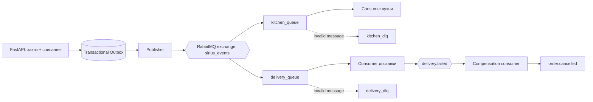

# Сириус.Еда

Учебный проект на FastAPI и Next.js. Вся документация собрана в папке **[docs](docs/README.md)**.

- [С чего начать и где что находится](docs/README.md)
- [Что осталось сделать по работам № 7–10](docs/iter-2/ЧТО_ОСТАЛОСЬ.md)
- [Запуск и проверка работ № 7–10](docs/iter-2/ЗАПУСК_ЛАБ_7-10.md)
- [Адреса сервисов и тестовые аккаунты](docs/справка/АДРЕСА_И_АККАУНТЫ.md)
- [Шпаргалка защиты работы № 9](docs/iter-2/ЗАЩИТА_ЛАБОРАТОРНАЯ_9.md)
- [Шпаргалка защиты работы № 10](docs/iter-2/ЗАЩИТА_ЛАБОРАТОРНАЯ_10.md)

Команды запуска выполняются из корня проекта:

```bash
docker compose up -d --build
cd sirius-food-frontend
npm ci
npm run dev
```

Для тестов из корня проекта: `uv sync --locked`, затем `uv run --locked pytest -q`. Интеграционным тестам нужен работающий Docker.

## Промокоды, лояльность и WebSocket-трекинг

Создание заказа принимает `promo_code` и `loyalty_points`:

```bash
curl -X POST http://127.0.0.1:8000/orders/create \
  -H "Authorization: Bearer $TOKEN" -H 'Content-Type: application/json' \
  -d '{"item_id":1,"quantity":2,"promo_code":"STUDENT10","loyalty_points":50}'
```

Администратор управляет кодами через `POST/GET /promocodes` и `DELETE /promocodes/{id}`. Истёкшие коды деактивирует Celery Beat каждую минуту. `order.paid` начисляет баллы (Bronze 3%, Silver 5%, Gold 7%), а `order.cancelled` идемпотентно возвращает списанные и отзывает начисленные баллы.

Для клиента откройте `/orders/{order_id}/track?token=<access-jwt>`. API принимает `PATCH /delivery/{delivery_id}/status` со статусами `assigned`, `picked_up`, `in_transit`, `arrived`, `delivered`. Обновления идут через Redis Pub/Sub `order_updates`; при переподключении клиент получает snapshot из PostgreSQL. URL для Next.js задаётся `NEXT_PUBLIC_WS_URL` в `.env.local`.

Нагрузочные сценарии: `uv run --locked locust -f locustfile_promos.py --users 1000 --spawn-rate 100` и `WS_TOKEN=... uv run --locked python scripts/load_websockets.py` (по умолчанию 100 соединений). ADR находится в [docs/adr/001-order-tracking-and-loyalty.md](docs/adr/001-order-tracking-and-loyalty.md).

## Проверки работы № 10

```bash
uv run --locked pytest -q tests/integration -v
uv run --locked pytest -q tests/contract -v
uv run --locked locust -f locustfile.py --host=http://127.0.0.1:8000
uv run --locked mutmut run
uv run --locked mutmut results
```

GitHub Actions запускает `uv run --locked pytest -q` на каждый `push` и `pull_request`; workflow находится в `.github/workflows/tests.yml`.

## Схема событийной обработки (работа № 7)



`processed_events` делает обработчики идемпотентными. Event publisher (`app/events/publisher.py`) и consumers (`app/events/consumer.py`) используют асинхронный `aio-pika`; общая логика находится в `app/events/common.py`, а `kombu` используется только внутри Celery. Если брокер недоступен, запись остаётся в Outbox с `published=false`; publisher отправляет её после восстановления RabbitMQ. Полный сценарий проверки описан в [инструкции Iter 2](docs/iter-2/ЗАПУСК_ЛАБ_7-10.md).
