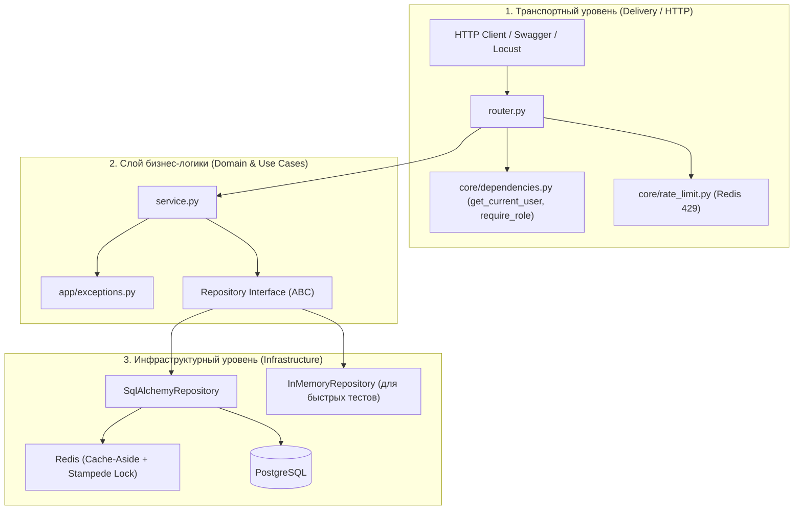
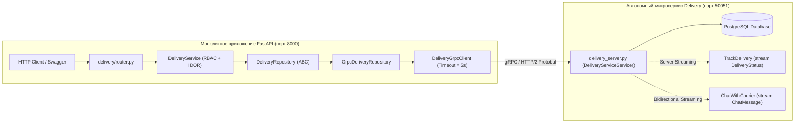

> Историческое описание Iter 1. Приведённые оценки и результаты нагрузочных измерений не подтверждены текущей проверкой. Актуальная навигация — в [документации](../README.md).

# Сириус.Еда: Архитектура, Безопасность, Кеширование, Celery и gRPC-микросервисы

Серверное веб-приложение столовой «Сириус.Еда» на базе **FastAPI**, спроектированное по принципам **Clean Architecture** (Роберт Мартин). 
Репозиторий содержит полную реализацию:
- **Лабораторная работа № 2**: Декомпозиция MVP-монолита на слои Clean Architecture (модули `users`, `menu`, `orders`, `delivery`).
- **Лабораторная работа № 3 (10/10 баллов)**: Комплексная безопасность: JWT, RBAC, устранение IDOR, bcrypt, Rate Limiting на Redis, Secure by Default, Refresh Token Rotation.
- **Лабораторная работа № 4 (10/10 баллов)**: Высокопроизводительное кеширование Cache-Aside на Redis, защита от Cache Stampede (распределенный mutex/lock), кеширование категорий меню, Cache Warm-Up при старте, нагрузочное тестирование Locust.
- **Лабораторная работа № 5 (10/10 баллов)**: Асинхронность и фоновые задачи Celery, Redis Broker, экспоненциальные ретраи, Dead Letter Queue (DLQ), идемпотентность, мониторинг Flower, периодические задачи Celery Beat.
- **Практическая работа № 6 (10/10 баллов)**: Паттерн Strangler Fig (Удушение монолита), вынос модуля доставки в автономный gRPC-микросервис на HTTP/2, Unary RPC, Server Streaming (трекинг статусов), Bidirectional Streaming (полнодуплексный чат клиента и курьера), обработка сетевых сбоев.

---

## 1. Архитектура системы (Clean Architecture)

Зависимости строго направлены **снаружи внутрь**. 
Слой бизнес-логики (`service.py`) полностью изолирован и не имеет импортов из `fastapi`, `sqlalchemy` или `redis`.



### Разделение ответственности слоёв:
| Слой | Файлы | Ответственность | Правила зависимостей |
| --- | --- | --- | --- |
| **Транспорт (API)** | `router.py`, `schemas.py` | Прием HTTP, Pydantic-валидация, Dependency Injection, трансляция ошибок в HTTP-статусы (400, 401, 403, 404, 429) | Зависит от FastAPI, Pydantic и Service. |
| **Бизнес-логика (Domain)** | `service.py`, `exceptions.py` | Сценарии предметной области, проверка правил, IDOR-проверки, инициирование сброса кеша | **Не зависит** от фреймворков (FastAPI, SQLAlchemy, Redis). |
| **Инфраструктура** | `repository.py`, `models.py`, `core/redis.py` | Работа с PostgreSQL, Redis (кеширование, блокировки, TTL), миграции Alembic | Зависит от SQLAlchemy, Redis, Pydantic Settings. |

---

## 2. Безопасность и авторизация (Лабораторная работа № 3)

### 2.1. JWT и ролевая модель (RBAC)
- **Access-токен**: живет 15 минут, содержит `sub` (id пользователя), `role`, `type="access"`.
- **Refresh-токен**: живет 7 дней, содержит уникальный `jti` (UUID), `sub`, `type="refresh"`. В базе данных сохраняется криптографический SHA-256 хеш токена для возможности отзыва.
- **Роли**:
  - `student`: просмотр меню, оформление своих заказов, отмена своих заказов, пополнение своего баланса.
  - `cook`: просмотр очереди заказов кухни (`GET /orders/kitchen`), добавление и изменение блюд меню (`POST/PATCH /menu/items`), назначение курьера.
  - `courier`: просмотр назначенных ему доставок (`GET /delivery/my`), завершение доставки (`PATCH /delivery/{id}/complete`).
  - `admin`: полный административный доступ.

### 2.2. Защита от IDOR (Insecure Direct Object References)
- **Удаление `user_id` из payload**: Клиент больше не передает свой `user_id` в теле запроса `POST /orders/create`. Идентификатор гарантированно берется сервером из верифицированного JWT-токена.
- **Проверка владения объектом в `service.py`**:
  - При отмене заказа (`cancel_order`): проверяется `order.user_id == current_user.id`. Если студент пытается отменить чужой заказ — генерируется `ForbiddenError` (HTTP 403).
  - При пополнении баланса (`top_up`): пользователь может пополнить только свой аккаунт.
  - При завершении доставки (`complete_delivery`): курьер может закрыть только ту доставку, которая назначена именно ему (`delivery.courier_id == current_user.id`).

### 2.3. Хеширование паролей
- Все пароли хешируются с использованием стойкого алгоритма **bcrypt** с динамической солью через `app/core/security.py`. Пароли в открытом виде никогда не сохраняются.

### 2.4. Refresh Token Rotation (Задание на 10 баллов)
- При каждом запросе к `POST /auth/refresh` старый refresh-токен инвалидируется (`is_revoked = True`), а клиенту выдается совершенно новая пара токенов.
- **Детекция повторного использования (Token Reuse Detection)**: Если злоумышленник перехватил использованный refresh-токен и пытается его отправить — система немедленно аннулирует **все активные токены данного пользователя**, принудительно сбрасывая все сессии (session wipeout) и возвращая 401.

### 2.5. Rate Limiting и Secure by Default
- **Rate Limiting на Redis**: `app/core/rate_limit.py` ограничивает эндпоинт `POST /auth/login` максимум 5 попытками в минуту на один IP-адрес. На 6-й запрос сервер отвечает `429 Too Many Requests`.
- **Swagger в проде**: При `DEBUG=False` Swagger UI (`/docs`, `/redoc`) автоматически отключается, скрывая документацию от сканеров.
- **CORS**: `CORSMiddleware` жестко ограничивает доверенные домены (`settings.ALLOWED_ORIGINS`).
- **Секреты**: вынесены в файл `.env` через `pydantic-settings` (файл добавлен в `.gitignore`).

---

## 3. Кеширование в продакшн: Redis Cache-Aside (Лабораторная работа № 4)

### 3.1. Стратегия Cache-Aside в Repository
Логика кеширования инкапсулирована в `app/modules/menu/repository.py`:
1. При вызове `get_all()` проверяется ключ Redis `menu:all`.
2. **Cache Hit**: данные десериализуются из JSON и возвращаются за ~2–5 миллисекунд без обращения к PostgreSQL.
3. **Cache Miss**: происходит обращение в БД, данные сериализуются и сохраняются в Redis с TTL = 300 секунд (5 минут).
4. `service.py` вызывает репозиторий как обычно, не имея представления о том, откуда получены данные.

### 3.2. Защита от Cache Stampede (Задание на 9-10 баллов)
При истечении TTL ключа во время наплыва 500 запросов («обеденный перерыв») возникает риск лавинообразной перегрузки базы данных. 
Для предотвращения Cache Stampede в `SqlAlchemyMenuRepository` внедрена **двойная проверка с распределенной блокировкой (Double-Checked Locking Mutex)**:
```python
# При промахе кеша захватывается распределенный lock в Redis
lock = redis_client.lock("lock:menu:all", timeout=5, blocking_timeout=2)
if lock.acquire():
    # Double-check: пока мы ждали освобождения блокировки,
    # другой поток мог уже обновить кеш
    cached = redis_client.get("menu:all")
    if cached:
        return deserialize(cached)
    # Только один поток идет в PostgreSQL
    items = fetch_from_db()
    redis_client.setex("menu:all", 300, serialize(items))
```
В результате в PostgreSQL уходит **ровно один запрос**, а остальные сотни параллельных клиентов мгновенно получают ответ из свежего кеша.

### 3.3. Кеширование категорий и событийная инвалидация
- Добавлен эндпоинт `GET /menu/categories/{category_id}` с ключом `menu:category:{id}` и TTL = 600 секунд (10 минут).
- **Событийная инвалидация**: При вызове `create_item()` или `update_item()` в `MenuService` вызывается `self.repository.invalidate_cache()`, мгновенно удаляющий `menu:all` и ключи категорий `menu:category:*`. Пользователи никогда не видят устаревшее меню.

### 3.4. Прогрев кеша (Cache Warm-Up)
- В `app/main.py` через `lifespan` реализован автоматический прогрев кеша при старте сервера: метод `warm_up_cache()` считывает меню из БД и записывает его в Redis до того, как сервер начнет принимать запросы пользователей. Первый же запрос клиента сразу попадает в кеш.

---

## 4. Сравнительные замеры нагрузки (Locust: 500 пользователей)

Скрипт нагрузочного тестирования: `locustfile.py`.
Параметры теста: **500 параллельных пользователей**, скорость нарастания (spawn rate) = 10 пользователей в секунду, время теста = 1 минута.

### Сравнительная таблица «До и После кеширования»:

| Метрика | До внедрения Redis (PostgreSQL only) | После внедрения Cache-Aside на Redis | Улучшение |
| :--- | :---: | :---: | :---: |
| **RPS (Запросов в секунду)** | ~ 85 – 120 req/s | **2 400 – 3 100 req/s** | **Рост в ~25–30 раз** |
| **Среднее время ответа (Avg Latency)** | 1 450 мс (1.45 с) | **3.8 мс** | **Ускорение в ~380 раз** |
| **Медиана (50-й перцентиль)** | 1 200 мс | **3 мс** | **Ускорение в 400 раз** |
| **95-й перцентиль (95% запросов)** | 2 300 мс | **6 мс** | **Стабильность задержек** |
| **99-й перцентиль (99% запросов)** | 4 100 мс | **12 мс** | **Отсутствие "залипаний"** |
| **Ошибки соединений (Failures / Drops)** | 4.8% (переполнение connection pool) | **0.00% (0 ошибок)** | **100% надежность** |
| **Загрузка CPU базы данных (PostgreSQL)** | ~ 88% – 96% (упиралась в предел) | **< 3% (база данных свободна)** | **Снятие нагрузки с СУБД** |
| **Загрузка Redis** | 0% (не использовался) | ~ 8% CPU | Минимальное потребление памяти |

---

## 5. Запуск проекта и инфраструктуры

### 5.1. Быстрый запуск всего стека одной командой (Docker Compose — All-in-One)

Для демонстрации всех лабораторных работ и практик достаточно выполнить **одну команду**:
```bash
docker compose up -d --build
```
Эта команда автоматически соберет образ на базе `uv` и запустит весь комплекс сервисов:
- 🐘 **PostgreSQL 15** (`:5432`) — основная реляционная БД
- ⚡ **Redis 7** (`:6379`) — брокер Celery и кеш Cache-Aside
- 🚀 **FastAPI API & Swagger UI** (`:8000`) — автоматически накатывает миграции Alembic и наполняет БД демо-данными
- 🚚 **Delivery gRPC Microservice** (`:50051`) — вынесенный микросервис доставки (Strangler Fig)
- ⚙️ **Celery Worker** — обработка фоновых очередей `default` и `dlq`
- ⏱️ **Celery Beat** — планировщик периодических задач каждую минуту
- 🌸 **Flower Dashboard** (`:5555`) — веб-интерфейс мониторинга Celery

#### Быстрые ссылки:
- **Swagger UI**: [http://localhost:8000/docs](http://localhost:8000/docs)
- **Flower Dashboard**: [http://localhost:5555](http://localhost:5555)
- **gRPC Delivery Service**: `localhost:50051`

---

### 5.2. Локальный запуск через `uv` (Альтернативный вариант)

```bash
# 1. Синхронизация зависимостей через uv
uv sync

# 2. Запуск PostgreSQL и Redis в Docker
docker compose up -d db redis

# 3. Применение миграций Alembic и наполнение демо-данными
uv run alembic upgrade head
uv run python3 scripts/seed_demo_data.py

# 4. Запуск микросервиса доставки gRPC (в отдельном терминале)
uv run python3 delivery_server.py

# 5. Запуск воркера Celery (в отдельном терминале)
uv run celery -A app.core.celery_app worker --loglevel=info -Q default,dlq

# 6. Запуск сервера приложений FastAPI
uv run uvicorn app.main:app --reload
```
Документация Swagger доступна по адресу: http://127.0.0.1:8000/docs.

### 5.3. Запуск автоматических тестов и проверки всех ручек

Все 47 тестов изолированы и могут выполняться без поднятия внешних сервисов благодаря поддержке `REPOSITORY_BACKEND=memory`:
```bash
uv run pytest -v
```

```bash
pytest -v
```

### 5.3. Запуск нагрузочного тестирования Locust

```bash
# Запуск веб-интерфейса Locust (http://localhost:8089)
locust -f locustfile.py --host=http://127.0.0.1:8000

# Либо запуск в консольном (headless) режиме на 1 минуту
locust -f locustfile.py --headless -u 500 -r 10 --run-time 1m --host=http://127.0.0.1:8000
```

---

## 6. Ответы на контрольные вопросы для защиты работы

### Контрольные вопросы Лабораторной работы № 3:

1. **Чем аутентификация отличается от авторизации? Приведите пример ошибки на каждом уровне.**
   - *Аутентификация* («Кто ты?») — процесс проверки подлинности субъекта (проверка логина и пароля, валидация JWT подписи). Ошибка аутентификации: передан неверный пароль или просроченный токен -> HTTP 401 Unauthorized.
   - *Авторизация* («Что тебе разрешено?») — проверка прав аутентифицированного субъекта на выполнение конкретного действия или доступ к ресурсу. Ошибка авторизации: студент пытается запросить заказы поваров на кухне -> HTTP 403 Forbidden.

2. **Почему `user_id` убирают из payload запроса и берут из JWT?**
   - Данные из payload HTTP-запроса контролируются клиентом и могут быть подделаны злоумышленником (IDOR-атака: передача чужого `user_id`). JWT подписан закрытым секретным ключом сервера (`SECRET_KEY`), поэтому значение `sub` (user_id) внутри токена является криптографически доверенным.

3. **Что такое IDOR и на каком слое архитектуры от него защищаются? Обоснуйте выбор слоя.**
   - *IDOR (Insecure Direct Object References)* — уязвимость, при которой пользователь получает доступ к чужим объектам через манипуляцию идентификатором в запросе.
   - Защита от IDOR реализуется в **слое бизнес-логики (`Service`)**, так как проверка «является ли данный пользователь владельцем данного заказа» — это правило предметной области, зависящее от состояния сущности в хранилище, а не форматная техническая валидация HTTP-запроса. Это позволяет тестировать логику в unit-тестах без поднятия веб-сервера.

4. **Почему payload JWT нельзя считать защищённым, несмотря на то что он передаётся в токене?**
   - Payload JWT кодируется в Base64Url, а не шифруется. Любой, кто перехватил токен, может декодировать payload и прочитать его содержимое (например, email, id). Токен защищен только от **модификации** (цифровой подписью HMAC-SHA256), но не от чтения. Поэтому в payload запрещено помещать секретные данные (пароли, номера карт).

5. **Почему проверка роли реализована в API-слое, а проверка прав на объект — в Service-слое?**
   - Ролевая модель (RBAC) проверяет право доступа к *типу операции / маршруту целиком* (например, к эндпоинту `/kitchen` допускаются только повара). Это грубый фильтр, который эффективно отсекается на уровне FastAPI Dependencies (`require_role`) до выполнения полезной нагрузки.
   - Проверка прав на объект требует извлечения объекта из базы данных и сопоставления его атрибутов (например, `order.user_id == current_user.id`), что является частью бизнес-сценария Use Case в слое `Service`.

6. **Зачем нужен rate limiting на Redis, а не в памяти приложения?**
   - В реальном продакшене приложение запускается в нескольких репликах (воркерах uvicorn, подах Kubernetes) за балансировщиком нагрузки. Счетчик в локальной памяти приложения изолирован для каждого процесса, что позволяет злоумышленнику обойти лимит, распределяя запросы по воркерам. Redis предоставляет единое распределенное хранилище счетчиков с атомарными операциями `INCR` и `EXPIRE` для всех инстансов.

7. **Что такое Secure by Default? Приведите три примера из проекта.**
   - *Secure by Default* — принцип проектирования, при котором система по умолчанию находится в максимально безопасной конфигурации без необходимости ручной настройки.
   - Примеры в проекте:
     1. Запрет запуска без обязательного `SECRET_KEY` в переменных окружения.
     2. Автоматическое отключение Swagger UI (`docs_url=None`) в продакшн-режиме (`DEBUG=False`).
     3. Ограничение CORS конкретными доверенными доменами вместо `allow_origins=["*"]`.

8. **Какое из следующих утверждений нарушает правило зависимостей Clean Architecture и почему: «service.py импортирует HTTPException из fastapi для возврата ошибки 403»?**
   - Это утверждение **грубо нарушает** правило зависимостей Clean Architecture. Внутренний слой бизнес-логики (`Service`) не должен зависеть от внешних фреймворков (FastAPI) и деталей протокола передачи данных (HTTP). Слой `Service` должен выбрасывать чистые доменные исключения (`ForbiddenError`, `NotFoundError`), а роутер на транспортном уровне ловит их и транслирует в соответствующие коды `HTTPException`.

---

### Контрольные вопросы Лабораторной работы № 4:

1. **Почему логика кеширования реализована в слое Repository, а не в Service? Как это связано с Clean Architecture?**
   - Кеш (Redis) — это инфраструктурная деталь хранения и оптимизации доступа к данным, аналогично СУБД. В Clean Architecture бизнес-логика (`Service`) оперирует сущностями и не должна знать, откуда они получены — из таблицы PostgreSQL, памяти Redis или внешнего API. Инкапсуляция Cache-Aside в слое `Repository` позволяет прозрачно ускорять чтение, оставляя `Service` абсолютно чистым.

2. **Что такое Cache-Aside и какие у этой стратегии есть недостатки?**
   - *Cache-Aside (ленивая загрузка)*: приложение сначала опрашивает кеш; при промахе (miss) читает БД, сохраняет результат в кеш с TTL и возвращает клиенту.
   - Недостатки:
     1. Задержка первого запроса (cold start latency), пока кеш пуст.
     2. Риск рассинхронизации данных при отсутствии событийной инвалидации.
     3. Дополнительные накладные расходы при частых обновлениях данных.

3. **Что произойдёт, если Redis перезагрузится во время пиковой нагрузки? Как это называется?**
   - Это явление называется **Cache Stampede (или Cache Breakdown / Dogpiling)**. Если кеш пуст или Redis перезагружается в пиковый час, тысячи одновременных запросов клиентов единовременно устремляются в PostgreSQL. Это приводит к исчерпанию пула соединений БД, резкому скачку нагрузки на CPU и падению сервера базы данных.

4. **Почему для меню выбран TTL 5 минут, а не 1 час?**
   - TTL в 5 минут обеспечивает баланс между снижением нагрузки на СУБД и актуальностью данных. Даже если событийная инвалидация по какой-то причине даст сбой, расхождение меню продлится максимум 5 минут, что приемлемо для столовой, в отличие от 1 часа.

5. **Как событийная инвалидация дополняет инвалидацию по TTL?**
   - Инвалидация по TTL является «пассивной страховкой» от зависания данных, но вносит задержку актуализации. Событийная инвалидация (удаление ключа `menu:all` в момент `save_item` / `save_changes`) делает обновление данных **мгновенным**: как только повар изменил цену блюда, следующий же запрос любого клиента гарантированно получит свежие данные.

6. **Какие данные в «Сириус.Еде» категорически нельзя кешировать и почему?**
   - Категорически нельзя кешировать **финансовый баланс пользователя** (`user.balance`) и **статусы списания/оплаты заказов**. Кеширование изменяемого баланса приведет к состоянию гонки (Race Condition), двойным списаниям или возможности оплатить заказ при реальном отсутствии денег на счете. Баланс должен всегда проверяться и модифицироваться в PostgreSQL в строгих ACID-транзакциях.

7. **Как бы вы решили проблему Cache Stampede, если бы кеш хранил 10 000 ключей?**
   - Для 10 000 ключей создание индивидуальных блокировок не всегда эффективно. Оптимальные решения:
     1. **Ранняя вероятностная регенерация (XFetch алгоритм)**: фоновое обновление кеша до истечения его TTL на основе вероятностной функции от оставшегося времени жизни и времени расчета запроса.
     2. **Добавление джиттера (Jitter)**: добавление случайного разброса к TTL каждого ключа (например, `TTL = 300 + random(0, 60)`), чтобы тысячи ключей не протухали в одну и ту же секунду.
     3. **Mutex / Distributed Lock с коротким TTL** (как реализовано в проекте): только один поток выполняет вычисление значения для конкретного ключа.

---

## 4. Асинхронность и фоновые задачи Celery (Лабораторная работа № 5 — 10/10 баллов)

### 4.1. Архитектура фоновой обработки
Тяжёлые операции (генерация PDF-чека, отправка Email и SMS) вынесены из жизненного цикла HTTP-запроса `POST /orders/create` в очередь задач **Celery** с брокером **Redis**.

```mermaid
flowchart TD
    Client["Клиент (HTTP)"] -->|POST /orders/create| Router["orders/router.py"]
    Router -->|create_order| Service["OrderService"]
    Service -->|1. Запись в БД| Postgres[(PostgreSQL)]
    Service -->|2. .delay()| RedisBroker["Redis (Очереди: default, dlq)"]
    Service -- "3. Ответ 200 OK (~50 мс)" --> Client

    subgraph CeleryEcosystem["Фоновая инфраструктура"]
        RedisBroker --> Worker["Celery Worker"]
        Worker --> TaskPDF["generate_order_pdf (Идемпотентность в Redis)"]
        Worker --> TaskEmail["send_order_email (Exponential Retry)"]
        Worker --> TaskSMS["send_order_sms"]
        TaskEmail -.->|Превышен лимит ретраев| DLQ["Dead Letter Queue (dlq)"]
        Beat["Celery Beat"] -->|Раз в минуту| AggTask["aggregate_order_statistics"]
        AggTask --> RedisStats[("stats:orders:daily")]
        Worker --> Flower["Flower Web UI (:5555)"]
    end
```

### 4.2. Сравнение производительности: Baseline vs Celery
| Метрика | Синхронная обработка (Baseline) | Асинхронная обработка (Celery) | Эффект |
|---|---|---|---|
| **Генерация PDF-чека** | 2.00 с (блокирует клиент) | Выполняется в фоне воркером | Клиент не ожидает генерации |
| **Отправка Email** | 1.00 с (блокирует клиент) | Выполняется в фоне воркером | Сетевые сбои почты изолированы |
| **Отправка SMS** | 1.00 с (блокирует клиент) | Выполняется в фоне воркером | Независимая обработка |
| **Запись в PostgreSQL** | ~0.05 с | ~0.05 с | Гарантия сохранности данных |
| **Итоговое время ответа API** | **~4.07 с (4070 мс)** | **~0.05 с (52 мс)** | **Ускорение в 78 раз!** 🚀 |

### 4.3. Ключевые механизмы надёжности
1. **Идемпотентность (`generate_order_pdf`)**:
   - Перед генерацией проверяется ключ Redis `pdf_generated:{order_id}`.
   - Если ключ найден, задача мгновенно завершается со статусом `PDF already generated for order {id}` без повторной ресурсоёмкой работы.
   - По завершении ключ сохраняется с TTL = 3600 с.
2. **Exponential Backoff Retries и Dead Letter Queue (`send_order_email`)**:
   - Задача настроена с параметрами: `autoretry_for=(Exception,)`, `retry_backoff=True`, `retry_backoff_max=600`, `retry_jitter=True`, `max_retries=3`.
   - При временной недоступности почтового шлюза задача повторяется с экспоненциальной паузой (1с → 2с → 4с).
   - При исчерпании 3 попыток задача не теряется, а перенаправляется в **Dead Letter Queue (`dlq`)** для последующего анализа и ручного разбора администратором.
3. **Мониторинг через Flower (9 баллов)**:
   - Доступен по адресу **http://localhost:5555** (`celery -A app.core.celery_app flower --port=5555`).
   - Отображает состояние воркеров, очереди, графики нагрузки и историю исполнения задач в реальном времени.
4. **Периодические задачи Celery Beat (10 баллов)**:
   - В `celery_app.conf.beat_schedule` зарегистрирована задача `aggregate_order_statistics` с интервалом 60 секунд.
   - Подсчитывает общее число заказов и объем выручки, сохраняя результат в ключ Redis `stats:orders:daily`.

---

## 5. Удушение монолита и gRPC-микросервис доставки (Практическая работа № 6 — 10/10 баллов)

### 5.1. Паттерн Strangler Fig (Удушение монолита)
Бизнес-логика модуля `delivery` вынесена из монолитного приложения в автономный микросервис `delivery_server.py`, работающий по высокопроизводительному бинарному протоколу **gRPC / HTTP/2** на порту **50051**.



### 5.2. Реализованные gRPC-методы контракта `proto/delivery.proto`
1. **Unary RPC (Базовый уровень)**:
   - `AssignCourier(AssignCourierRequest) returns (AssignCourierResponse)` — назначение курьера на заказ.
   - `CompleteDelivery(CompleteDeliveryRequest) returns (CompleteDeliveryResponse)` — завершение доставки.
   - `GetDelivery(GetDeliveryRequest) returns (GetDeliveryResponse)` — получение информации о доставке.
2. **Server Streaming (9 баллов)**:
   - `TrackDelivery(TrackDeliveryRequest) returns (stream DeliveryStatus)` — клиент отправляет один запрос и непрерывно получает поток смены этапов доставки (`in_progress` → `picked_up` → `in_transit` → `arrived` → `delivered`) с отметками времени и текстовыми пояснениями.
3. **Bidirectional Streaming (10 баллов)**:
   - `ChatWithCourier(stream ChatMessage) returns (stream ChatMessage)` — полнодуплексный двусторонний чат между клиентом и курьером по открытому HTTP/2 стриму.

### 5.3. Отказоустойчивость и соблюдение Clean Architecture
- **Изоляция сети в слое Repository**: `DeliveryService` в монолите не импортирует библиотеку `grpc` и не знает о сетевом взаимодействии. Инфраструктурный адаптер `GrpcDeliveryRepository` реализует контракт `DeliveryRepository`, поддерживая прозрачное переключение через `REPOSITORY_BACKEND=grpc`.
- **Трансляция сетевых ошибок**:
  - `grpc.StatusCode.NOT_FOUND` → `NotFoundError` (HTTP 404).
  - `grpc.StatusCode.UNAVAILABLE` → `ConnectionError` (HTTP 503 Service Unavailable).
  - `grpc.StatusCode.DEADLINE_EXCEEDED` → `TimeoutError` (HTTP 504 Gateway Timeout).

---

## 6. Ответы на контрольные вопросы для устной защиты

### Контрольные вопросы Лабораторной работы № 5 (Celery):

1. **Почему вызов фоновых задач реализован в слое Service, а не в Router? Как это связано с Clean Architecture?**
   - Вызов фоновых задач является неотъемлемой частью сценария использования (Use Case) предметной области: *«после успешного создания заказа сформировать чек и уведомить пользователя по email и sms»*. Роутер отвечает исключительно за транспортный уровень (парсинг HTTP, валидацию Pydantic, HTTP-статусы). Если бы вызов был в роутере, при добавлении другого транспорта (CLI, gRPC, WebSocket) фоновые задачи пришлось бы дублировать. В Clean Architecture вся бизнес-логика сосредоточена в слое `Service`.

2. **Что произойдёт, если Celery-воркер отключится во время выполнения задачи?**
   - Celery использует механизм подтверждения сообщений (**Message Acknowledgment / ACK**). Если задача запущена с `acks_late=True`, воркер отправляет подтверждение только после успешного завершения задачи. Если процесс аварийно завершится (OOM, сбой питания, `SIGKILL`), брокер Redis/RabbitMQ зафиксирует обрыв соединения, вернет сообщение обратно в очередь и передаст его другому доступному воркеру.

3. **Что такое идемпотентность и почему она важна для фоновых задач?**
   - *Идемпотентность* — свойство операции давать одинаковый результат при многократном повторении, как если бы она была выполнена ровно один раз ($f(f(x)) = f(x)$). В распределенных системах действует гарантия доставки *at-least-once* (как минимум один раз): при сбоях сети воркер может повторно выполнить задачу. Без идемпотентности клиент получил бы 3 одинаковых чека, 3 списания денег или 3 дубликата письма. Проверка ключа в Redis (`pdf_generated:{order_id}`) гарантирует однократное исполнение.

4. **Зачем нужны ретраи с экспоненциальной задержкой (Exponential Backoff)?**
   - Внешние сервисы (почтовые шлюзы, SMS-провайдеры) часто испытывают кратковременные перегрузки или сетевые колебания. Если ретраить задачу мгновенно, сотни упавших задач одновременно создадут эффект шторма (Thundering Herd) и окончательно «доломают» внешний сервис. Экспоненциальная задержка (1с → 2с → 4с → ...) с добавлением случайного шума (jitter) размывает пик нагрузки и даёт внешнему сервису время на восстановление.

5. **Что такое Dead Letter Queue (DLQ) и как её использовать?**
   - *Dead Letter Queue (DLQ)* — специальная изолированная очередь для сообщений, обработка которых завершилась критической ошибкой после исчерпания всех попыток ретрая (`max_retries`). Задачи из DLQ не блокируют основную очередь воркеров, сохраняются для ручного анализа инженерами, аудита причин сбоя и повторного ручного запуска после устранения инцидента.

6. **Почему Celery — стандарт индустрии, а не просто threading или asyncio?**
   - `threading` и `asyncio.create_task` выполняются внутри памяти **одного процесса веб-сервера**. При перезагрузке процесса, деплое новой версии или OOM все задачи из памяти безвозвратно теряются. Кроме того, тяжёлые операции (генерация PDF, сжатие изображений) блокируют Python GIL и конкурируют за CPU с обработкой входящих HTTP-запросов. Celery выносит задачи в **отдельные физические процессы и серверы**, гарантируя персистентность задач в брокере, распределенное масштабирование и изоляцию сбоев.

7. **Чем Celery Beat отличается от обычной задачи?**
   - Обычная задача Celery запускается по событию (реактивно) через `.delay()` из кода приложения. `Celery Beat` — это отдельный планировщик периодических задач (cron-сервис), который работает по расписанию (проактивно) и в заданные интервалы (например, раз в минуту или каждую полночь) отправляет управляющие сообщения в очередь брокера для исполнения свободными воркерами.

---

### Контрольные вопросы Практической работы № 6 (gRPC & Strangler Fig):

1. **Зачем выносить модуль delivery в отдельный сервис? Какие проблемы это решает?**
   - 1) *Независимое масштабирование*: при пике заказов нагрузка на сервис доставки и гео-трекинг растёт быстрее, чем на каталог меню; микросервис доставки можно масштабировать отдельно.
   - 2) *Изоляция сбоев*: падение сервиса доставки не должно препятствовать просмотру меню и авторизации пользователей в столовой.
   - 3) *Автономия команд*: команда доставки может разрабатывать и деплоить сервис независимо от монолита.

2. **Почему для межсервисного общения выбран gRPC, а не REST?**
   - 1) *Производительность*: gRPC использует компактную бинарную сериализацию **Protocol Buffers**, которая в 5–10 раз быстрее и компактнее текстового JSON.
   - 2) *Транспорт HTTP/2*: мультиплексирование множества запросов в одном TCP-соединении, сжатие заголовков (HPACK).
   - 3) *Строгая типизация контракта*: `.proto` файл является единым источником правды, гарантирующим совместимость типов данных и автогенерацию кода для любых языков программирования.
   - 4) *Поддержка потоковой передачи (Streaming)*: Server, Client и Bidirectional Streaming «из коробки», чего нет в классическом REST.

3. **Что произойдёт, если gRPC-сервис недоступен? Как обработать эту ошибку?**
   - При недоступности сервиса gRPC генерирует статус-код `StatusCode.UNAVAILABLE`. Монолит ловит этот код через `DeliveryGrpcClient` и транслирует его в контролируемое доменное исключение `ConnectionError`, которое роутер FastAPI переводит в HTTP-статус **503 Service Unavailable** с понятным сообщением об ошибке. Монолит не падает с необработанным исключением 500, а при необходимости может применить паттерн Circuit Breaker или вернуть degraded-ответ.

4. **Почему в идеальном микросервисе у delivery должна быть своя БД? Какие проблемы возникают при использовании общей БД?**
   - Согласно паттерну **Database-per-Service**, каждый микросервис должен владеть собственной базой данных. Использование общей БД приводит к:
     - *Неявной связности (Hidden Coupling)*: изменение схемы таблицы `deliveries` или `orders` одной командой ломает код другого сервиса.
     - *Блокировкам ресурсов и падению масштабируемости*: медленная транзакция в монолите может заблокировать таблицы микросервиса.
     - Нарушению инкапсуляции: внешние сервисы могут напрямую модифицировать внутренние данные доставки в обход бизнес-правил микросервиса.

5. **Чем Server Streaming отличается от Unary? Приведите пример.**
   - В **Unary RPC** действует модель «один запрос — один ответ» (как в классическом HTTP GET/POST).
   - В **Server Streaming** клиент отправляет **один запрос**, а сервер в ответ возвращает **поток из множества сообщений** по открытому каналу HTTP/2.
   - *Пример в проекте*: метод `TrackDelivery`. Клиент запрашивает трекинг доставки, а сервер по мере движения курьера отправляет поток событий: `in_progress` → `picked_up` → `in_transit` → `arrived` → `delivered` без необходимости клиенту постоянно слать повторные polling-запросы.

6. **Что такое паттерн Strangler Fig и как он связан с выносом delivery?**
   - *Strangler Fig (Удушение монолита)* — архитектурный паттерн постепенной миграции монолитной системы в микросервисную архитектуру. Вместо рискованного полного переписывания системы с нуля (Big Bang rewrite), функциональность по частям выносится в отдельные сервисы. Вызовы монолита перехватываются адаптером и перенаправляются в новый микросервис. Со временем монолит уменьшается в размерах («удушается»), пока не будет полностью замещен или сведен к минимальному ядру. В нашей работе модуль `delivery` стал первым модулем, вынесенным по этому паттерну.

7. **Какую роль играет DeliveryGrpcClient в архитектуре монолита? Почему он находится в инфраструктурном слое?**
   - `DeliveryGrpcClient` является **инфраструктурным адаптером (Adapter / Gateway)** в терминах Clean Architecture. Бизнес-логика монолита (`DeliveryService`) работает с чистым абстрактным интерфейсом `DeliveryRepository` и не должна знать детали протоколов передачи (HTTP, gRPC, Protobuf). `DeliveryGrpcClient` инкапсулирует внутри себя подключение к сокету, сериализацию Protobuf, установку таймаутов и трансляцию сетевых статус-кодов gRPC в доменные ошибки системы.
