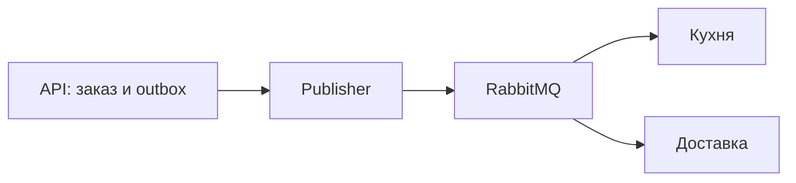

# Практические работы 7–10

## Запуск

Из корня проекта:

```bash
docker compose up --build -d
cd sirius-food-frontend
npm ci
npm run dev
```

API: http://localhost:8000/docs; витрина: http://localhost:3000/menu; CSR: http://localhost:3000/menu-csr; RabbitMQ: http://localhost:15672 (sirius / sirius); Prometheus: http://localhost:9090; Grafana: http://localhost:3001 (admin / admin). Демо-учётные записи — в [справочнике адресов и аккаунтов](../справка/АДРЕСА_И_АККАУНТЫ.md).

## 7. События заказов

Для автоматической демонстрации всех основных сценариев работы № 7 запустите из корня проекта (нужны Docker и `uv`):

```bash
uv sync --locked
uv run --locked python scripts/verify_lab7.py
```

Скрипт запускает основной Docker Compose стек и выводит PASS/FAIL для обычной доставки, дубликата, DLQ, Saga и Outbox при отказе RabbitMQ. Он временно останавливает RabbitMQ и блокирует доступных курьеров, поэтому во время проверки другие заказы могут обработаться иначе. Скрипт восстанавливает состояние тех курьеров, которых сам изменил, и запускает брокер снова. Тестовый пользователь, заказы и события остаются в основной базе; тестовые сообщения — в DLQ. При ошибке скрипт возвращает ненулевой код и пытается восстановить состояние. При принудительном завершении процесса восстановление может потребоваться вручную.

Во время выполнения скрипт печатает семь шагов. Положительный сценарий явно проверяет `POST /orders/create`, публикацию `OrderPaid`, обработку кухней и доставкой и выводит ссылки на `kitchen_queue` и `delivery_queue`. После шага DLQ он выводит прямую ссылку на `kitchen_dlq`. В конце печатаются ссылки на все очереди и готовая команда `docker compose exec -T db psql ...` для просмотра заказов, Outbox, `kitchen_orders`, `deliveries` и компенсации в PostgreSQL. Логин RabbitMQ: `sirius`, пароль: `sirius`.

Нормальная отправка `OrderPaid` запускается ручкой `POST /orders/create`: она списывает баланс и в одной транзакции сохраняет заказ, баланс и событие Outbox. Отдельный publisher отправляет событие в RabbitMQ с подтверждением. При недоступном брокере событие остаётся в БД; при сбое после отправки возможен повтор. Кухня и доставка обрабатывают события независимо, сохраняют ключи обработанных событий в БД; некорректные сообщения направляются в DLQ. В этом проекте создание заказа считается оплатой с баланса. Доставка назначает доступного курьера. Если курьера нет, `delivery.failed` запускает компенсацию: заказ отменяется, а списанная сумма возвращается один раз.

RabbitMQ publisher и consumer реализованы на асинхронном клиенте `aio-pika`: публикация ждёт broker confirm через `await`, consumer читает очередь через async iterator, а при разрыве соединения выполняется reconnect. Код разделён на `app/events/publisher.py` и `app/events/consumer.py`; общие очереди и транзакции находятся в `app/events/common.py`. Синхронные SQL-транзакции consumer’ов запускаются через `asyncio.to_thread`, чтобы не блокировать цикл событий. `kombu` остаётся только транзитивной зависимостью Celery и не используется в event-driven части работы № 7.



Проверка: создать заказ в Swagger, посмотреть `docker compose logs event_publisher kitchen delivery_events`; очереди и DLQ доступны в интерфейсе RabbitMQ. Для демонстрации восстановления можно остановить RabbitMQ, создать заказ, затем вернуть брокер и проверить публикацию. События доставляются как минимум один раз; глобальной гарантии exactly-once нет.

Сквозные сценарии, включая повтор, DLQ, компенсацию и восстановление после отказа брокера, проверяются приведённым выше скриптом на реальных RabbitMQ и PostgreSQL.

## 8. SSR

`/menu` и `/menu/{id}` получают данные с API на сервере; при отсутствии блюда возвращается 404. Есть состояния загрузки и ошибки, метаданные и обновление кэша через 60 секунд. `menu-csr` загружает данные в браузере. Из-за кэша Redis на API сроки появления изменений зависят также от его инвалидации; при изменении меню через API кеш инвалидируется.

Сравните HTML через «Просмотр кода страницы». Для измерений откройте DevTools → Network, отключите cache и сделайте по три загрузки `/menu` и `/menu-csr`. Запишите фактические результаты: заранее они не известны.

## 9. Метрики и логи

Отправьте `X-Correlation-ID: demo-42` при создании заказа. Идентификатор возвращается в ответе и сохраняется в outbox, проходит через RabbitMQ и выводится в JSON-логах API и обработчиков.

```bash
docker compose logs api kitchen delivery_events | grep demo-42
```

В Grafana откройте дашборд «Сириус.Еда»: RPS, p95 и очередь RabbitMQ. OpenTelemetry сохраняет контекст трассировки вместе с событием в outbox и передаёт его потребителю через RabbitMQ. Jaeger доступен на http://localhost:16686: выберите сервис `sirius-api` и найдите цепочку API → publisher → kitchen. Проверить сквозной трейс можно только после запуска контейнеров.

В списке Service нужно именно выбрать `sirius-api`, а затем нажать **Find Traces**. `GET /menu/items` — обычный запрос меню, в нём нет событий кухни и доставки. Для сквозного трейса создайте заказ через `POST /orders/create`, затем выберите операцию `POST /orders/create`, обновите поиск и откройте результат. Фоновые сервисы появляются в списке после обработки события. Jaeger хранит данные в памяти: после перезапуска контейнера старые трейсы пропадают. Служебный `/metrics` исключён из трассировки после пересборки API.

### Sentry

SDK уже установлен и включается при наличии `SENTRY_DSN`. Для облачного Sentry создайте проект платформы **Python/FastAPI** на https://sentry.io и скопируйте DSN из Project Settings → Client Keys (DSN). В корневом `.env` задайте `SENTRY_DSN`. Не публикуйте `.env`. Официальный self-hosted Sentry требует отдельного большого стека и в Compose приложения не запускается.

Для проверки пересоздайте API с `SENTRY_TEST_ENABLED=1` в корневом `.env`: `docker compose up -d --force-recreate api`. Затем выполните `curl -H 'X-Correlation-ID: sentry-demo' http://localhost:8000/__debug__/sentry`: ответ HTTP 500 ожидается. В Sentry откройте Issues и найдите ошибку с тегом `correlation_id=sentry-demo`. Верните `SENTRY_TEST_ENABLED=0` и снова пересоздайте API. Без DSN отправки нет; факт ответа 500 сам по себе не подтверждает доставку события.

## 10. Проверки

```bash
uv run pytest -q
uv sync --locked
uv run --locked pytest tests/integration tests/contract -v
uv run --locked mutmut run
uv run --locked mutmut results
uv run locust -f locustfile.py --host=http://127.0.0.1:8000
```

Для создания заказов нагрузочным тестом задайте `LOCUST_TOKEN` и при необходимости `LOCUST_ITEM_ID`; без токена тестирует только чтение. Создание заказов списывает деньги с баланса, используйте тестовые данные. Сравните 50 и 200 пользователей в Locust и зафиксируйте RPS, p95, ошибки и метрики Grafana. Короткие прогоны проведены; узкое место пока не выявлено. Результаты см. в [отчёте](РЕЗУЛЬТАТЫ_ПРОВЕРКИ.md). Контрактный тест использует Pact для проверки сообщения потребителем и производителем; также проверяет, что переименование `total` в `amount` ломает контракт. Mutmut запущен до и после усиления тестов; результаты и ограничения приведены в [отчёте](РЕЗУЛЬТАТЫ_ПРОВЕРКИ.md). CI запускает pytest при push и pull request; обязательную проверку для блокировки merge настраивают в настройках защиты ветки GitHub.
